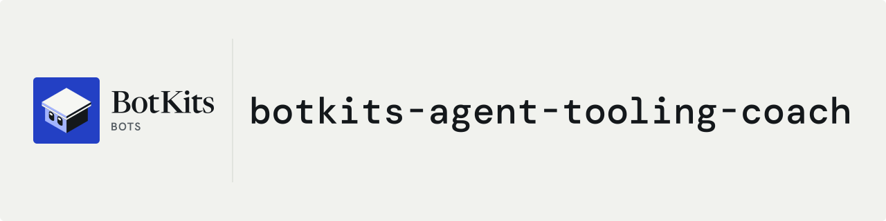

<picture><source media="(prefers-color-scheme: dark)" srcset="../../assets/bots/header-botkits-agent-tooling-coach-dark.png 1x, ../../assets/bots/header-botkits-agent-tooling-coach-dark@2x.png 2x"></picture>

# botkits-agent-tooling-coach

A bot that reviews an agent's tools, plans how it wakes on events, and checks a skill or model change before it goes live.

Use this when you want one bot for those three jobs, instead of loading the skills one by one.

## Install

Copy this folder and the skill folders it names. Then paste [PACK.md](PACK.md) into your bot and ask it to take this job, or point an agent at the folder.

The pack names these skills, already in this repo:

- [botkits-mcp-tool-surface-review](../../skills/engineering/botkits-mcp-tool-surface-review/)
- [botkits-event-wake-plan](../../skills/bots/botkits-event-wake-plan/)
- [botkits-skill-upgrade-check](../../skills/bots/botkits-skill-upgrade-check/)

To install one skill: `npx skills add botkitsdev/botkits --skill <skill-name>`.

## What it does

- Reviews an MCP server's tool list against ten per-tool checks and six server checks, then rewrites the two worst tools. It never calls the tools.
- Plans an agent that wakes on a webhook, stream, timer or poll: duplicates, event text as data, human taps for change and for send or spend, and four test events including a hostile one.
- Pins a skill, runs 5 test tasks before and after a skill or model change, and returns a keep or hold verdict.
- Asks you to pick, on a card, which tool rewrite to apply, whether an event wake may go live after a dry run, or whether to keep or hold a skill change.
- It does not write server code, turn on the trigger, accept an upgrade, or create a new bot. A passing review does not make a system safe.

## Before / after (example)

### Before

Your server has one tool, `ask_assistant`, that takes a sentence and returns a paragraph. You also want the agent to reply to every new support email on its own.

### After

The tool review marks `ask_assistant` as a fix and writes smaller, typed tools. The event plan has the agent draft replies, not send them, and a hostile test email is flagged. You pick, on a card, whether the event wake may go live after the dry run. This is a made-up example.

## Use it in

- Built in Grok Bot. Not in daily use yet. Not run on a real project yet.
- Installs with `npx skills add` for the skills it lists (tested 18 Nov 2026): Claude Code, Codex, Cursor, Gemini CLI, GitHub Copilot and Grok Build. The pack itself is a `PACK.md` you load as the bot's job. We have not shipped it as a Grok Bot template.
- Other agents that support a persona plus skills can load it. We have not run the pack there.

Tappable approval cards need a bot that can show them (Grok Bot does). Without cards, the bot still presents real options and waits for a clear pick. It must not invent a letter menu as a substitute for a card when cards are available.

| Agent | How to load it |
| --- | --- |
| Grok Bot | Paste [PACK.md](PACK.md) in a 1:1 chat and ask the Bot to take this job and save the listed skills. |
| Claude Code, Codex, Cursor, Gemini CLI, GitHub Copilot, Grok Build | Install the listed skills with `npx skills add`, then add `PACK.md` as the agent's instructions. |

Install tested is not run tested.

## Links

- [botkits.dev](https://botkits.dev)
- Pack: [PACK.md](PACK.md)

License: MIT
