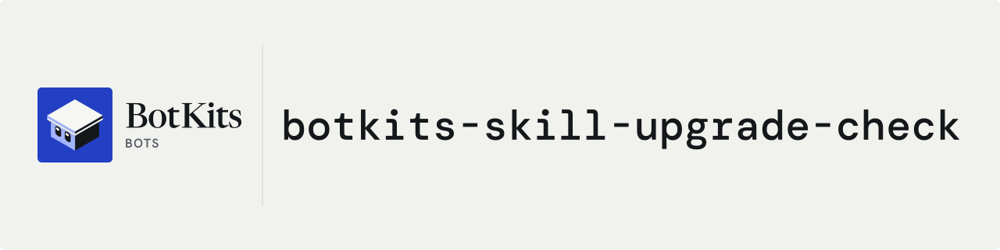

<picture><source media="(prefers-color-scheme: dark)" srcset="../../../assets/skills/header-botkits-skill-upgrade-check-dark.png 1x, ../../../assets/skills/header-botkits-skill-upgrade-check-dark@2x.png 2x"></picture>

# botkits-skill-upgrade-check

Test a skill change before you accept it: pin the old version, run 5 small tasks before and after, and get a keep or hold verdict.

Use this before you update a skill, or before you switch the model that runs it.

## Install

```sh
npx skills add botkitsdev/botkits --skill botkits-skill-upgrade-check
```

To list every skill in the repo: `npx skills add botkitsdev/botkits --list`.

No CLI? Copy this folder into the skills folder your agent uses, and keep `SKILL.md` inside it. Copy the skill folder itself, not the category folder.

## What it does

- Pins the current skill with a file fingerprint, the model name and the date, and copies the old folder so you can go back.
- Writes 5 test tasks from your real work: typical, edge, missing input, out of scope and costly mistake. Each task lists what must be true, not exact words.
- Runs them before and after the change, in a dry run when a task acts on the world, and twice when results vary.
- Shows one table of met items before and after, and lists each item that got worse.
- Gives a verdict: keep, hold or not enough to say. On hold it restores the old version.
- It checks behavior, not wording. Five tasks catch big changes and do not prove a skill is safe.

## Before / after (example)

### Before

A skill you use for refund emails has a new version on GitHub. The text reads well, so you plan to copy it over.

### After

You run 5 tasks on both versions. The new version stops asking which order the refund is for. The table shows one item moved from met to not met, the verdict is hold, and the old folder is restored. This is a made-up example.

## Use it in

- Built in Grok Bot. Not in daily use yet. Not run on a real project yet.
- Installs with `npx skills add` (tested 18 Nov 2026): Claude Code, Codex, Cursor, Gemini CLI, GitHub Copilot and Grok Build.
- Supports the SKILL.md format (vendor docs): Claude apps (upload), ChatGPT (Business, Enterprise, Edu, Healthcare upload), and the other clients listed at [agentskills.io](https://agentskills.io/clients).
- Other agents that support the Agent Skills format can load it. We have not run it there.
- No direct install yet in ChatGPT dots or Meta Muse. Paste the instructions from [SKILL.md](SKILL.md) into a chat.

The agent needs a shell for the fingerprint step. Without one, it records the version by hand. Tasks run in a dry run, never on real accounts.

| Agent | Put this folder here |
| --- | --- |
| Grok Bot | Paste [SKILL.md](SKILL.md) in a 1:1 chat and ask the Bot to save it as a skill. |
| Claude Code | `.claude/skills/botkits-skill-upgrade-check/` or `~/.claude/skills/botkits-skill-upgrade-check/` |
| Codex | `.agents/skills/botkits-skill-upgrade-check/` or `~/.agents/skills/botkits-skill-upgrade-check/` |
| Cursor | `.agents/skills/botkits-skill-upgrade-check/` or `.cursor/skills/botkits-skill-upgrade-check/` |
| Gemini CLI | `.gemini/skills/botkits-skill-upgrade-check/` or `.agents/skills/botkits-skill-upgrade-check/` (one folder deep only) |
| GitHub Copilot | `.github/skills/botkits-skill-upgrade-check/` or `.agents/skills/botkits-skill-upgrade-check/` |
| Grok Build | `.grok/skills/botkits-skill-upgrade-check/` or `~/.grok/skills/botkits-skill-upgrade-check/` |
| Claude apps | Turn on code execution. ZIP this folder and upload in Customize, Skills. |

Install tested is not run tested.

## Links

- [botkits.dev](https://botkits.dev)
- Instructions: [SKILL.md](SKILL.md)

License: MIT
