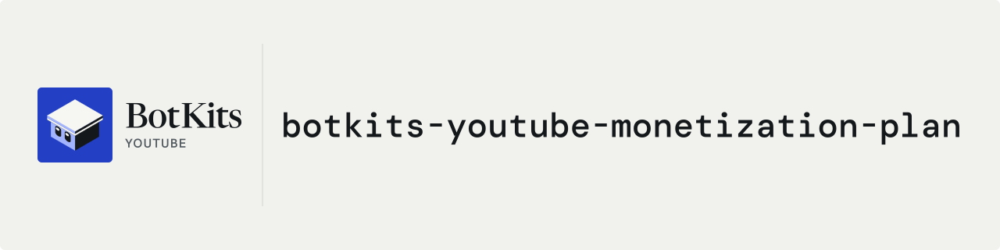

<picture><source media="(prefers-color-scheme: dark)" srcset="../../../assets/skills/header-botkits-youtube-monetization-plan-dark.png 1x, ../../../assets/skills/header-botkits-youtube-monetization-plan-dark@2x.png 2x"></picture>

# botkits-youtube-monetization-plan

Turn "get monetized" into a week-by-week plan, built from your real numbers, with a pace check and a weekly review.

Use this when a YouTube channel wants to reach the YouTube Partner Program thresholds and needs a plan it can check each week.

## Install

```sh
npx skills add botkitsdev/botkits --skill botkits-youtube-monetization-plan
```

To list every skill in the repo: `npx skills add botkitsdev/botkits --list`.

No CLI? Copy this folder into the skills folder your agent uses, and keep `SKILL.md` inside it. Copy the skill folder itself, not the category folder.

## What it does

- Opens the official YouTube Partner Program page first and writes down the date it read the thresholds. The numbers change, so it does not rely on memory.
- Asks for your subscribers, qualified watch hours, Shorts views, weekly hours and time per video.
- Sizes the gap and picks one route: long-form watch hours or Shorts views.
- Checks the pace. It turns the gap into a number needed per video and compares it with what you can make. The result is one of three: reachable on paper, a stretch, or not in this window.
- Writes one `youtube-monetization-plan.md` with a weekly rhythm, three phases, a policy checklist and what to try after the threshold.
- Runs a four-number weekly review that changes one thing at a time.
- It does not promise a date or an income, and it does not plan paid reach or bought views.

## Before / after (example)

### Before

A channel has 120 subscribers and 300 watch hours. The owner has 5 hours a week and each video takes 4 hours. The plan so far is "post more".

### After

The plan shows the gap (880 subscribers, 3,700 hours), the route (long-form), and the pace: about one video a week. It says what each video would need to earn, compares that with the channel's own median, and marks the result as a stretch or not in this window. It adds a weekly rhythm and the review. This is a made-up example.

## Use it in

- Built in Grok Bot. Not in daily use yet. Not run on a real channel yet.
- Installs with `npx skills add` (tested 18 Nov 2026): Claude Code, Codex, Cursor, Gemini CLI, GitHub Copilot and Grok Build.
- Supports the SKILL.md format (vendor docs): Claude apps (upload), ChatGPT (Business, Enterprise, Edu, Healthcare upload), and the other clients listed at [agentskills.io](https://agentskills.io/clients).
- Other agents that support the Agent Skills format can load it. We have not run it there.
- No direct install yet in ChatGPT dots or Meta Muse. Paste the instructions from [SKILL.md](SKILL.md) into a chat.

The agent can open web pages to read the official threshold page. Without web access, it marks the thresholds as unchecked. It reads your numbers from you, not from YouTube.

| Agent | Put this folder here |
| --- | --- |
| Grok Bot | Paste [SKILL.md](SKILL.md) in a 1:1 chat and ask the Bot to save it as a skill. |
| Claude Code | `.claude/skills/botkits-youtube-monetization-plan/` or `~/.claude/skills/botkits-youtube-monetization-plan/` |
| Codex | `.agents/skills/botkits-youtube-monetization-plan/` or `~/.agents/skills/botkits-youtube-monetization-plan/` |
| Cursor | `.agents/skills/botkits-youtube-monetization-plan/` or `.cursor/skills/botkits-youtube-monetization-plan/` |
| Gemini CLI | `.gemini/skills/botkits-youtube-monetization-plan/` or `.agents/skills/botkits-youtube-monetization-plan/` (one folder deep only) |
| GitHub Copilot | `.github/skills/botkits-youtube-monetization-plan/` or `.agents/skills/botkits-youtube-monetization-plan/` |
| Grok Build | `.grok/skills/botkits-youtube-monetization-plan/` or `~/.grok/skills/botkits-youtube-monetization-plan/` |
| Claude apps | Turn on code execution. ZIP this folder and upload in Customize, Skills. |

Install tested is not run tested.

## Links

- [botkits.dev](https://botkits.dev)
- Instructions: [SKILL.md](SKILL.md)

License: MIT
