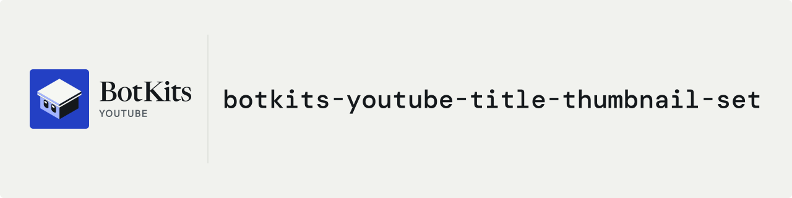

<picture><source media="(prefers-color-scheme: dark)" srcset="../../../assets/skills/header-botkits-youtube-title-thumbnail-set-dark.png 1x, ../../../assets/skills/header-botkits-youtube-title-thumbnail-set-dark@2x.png 2x"></picture>

# botkits-youtube-title-thumbnail-set

Pick the title and thumbnail for one video as a pair: 10 honest titles, 3 thumbnail concepts, a score table and a ranked pick.

Use this when one YouTube video or Short needs its title and thumbnail chosen before you publish.

## Install

```sh
npx skills add botkitsdev/botkits --skill botkits-youtube-title-thumbnail-set
```

To list every skill in the repo: `npx skills add botkitsdev/botkits --list`.

No CLI? Copy this folder into the skills folder your agent uses, and keep `SKILL.md` inside it. Copy the skill folder itself, not the category folder.

## What it does

- Asks for the topic, the one thing the viewer gets, who clicks, and any real proof in the video (a number, a clip, an object).
- Writes one promise line. Every title and thumbnail must be true to it.
- Writes 10 titles across ten shapes, so they are not one idea repeated. It strikes any title the video does not deliver early.
- Writes 3 thumbnail concepts. Each has one picture, three words or fewer, a contrast note, and one line on what it adds to the title.
- Scores titles and concepts from 0 to 2 on six checks and ranks them. It returns the pair it suggests and one spare pair.
- Adds a phone-size check: can you read it, can you tell the topic, does it work in black and white.
- It does not make the image and it does not read live YouTube data. Click rates come from your Studio.

## Before / after (example)

### Before

You have a Short about why bread goes stale. The working title is "Bread facts". The thumbnail is a screenshot of the first frame.

### After

You get a promise line, 10 titles ranked with scores, 3 thumbnail concepts with 3 words or fewer, the pair to publish, and a spare pair for later. This is a made-up example.

## Use it in

- Built in Grok Bot. Not in daily use yet. Not run on a real channel yet.
- Installs with `npx skills add` (tested 18 Nov 2026): Claude Code, Codex, Cursor, Gemini CLI, GitHub Copilot and Grok Build.
- Supports the SKILL.md format (vendor docs): Claude apps (upload), ChatGPT (Business, Enterprise, Edu, Healthcare upload), and the other clients listed at [agentskills.io](https://agentskills.io/clients).
- Other agents that support the Agent Skills format can load it. We have not run it there.
- No direct install yet in ChatGPT dots or Meta Muse. Paste the instructions from [SKILL.md](SKILL.md) into a chat.

The agent needs no tools. To make the image from a chosen concept, hand it to an image tool or a designer.

| Agent | Put this folder here |
| --- | --- |
| Grok Bot | Paste [SKILL.md](SKILL.md) in a 1:1 chat and ask the Bot to save it as a skill. |
| Claude Code | `.claude/skills/botkits-youtube-title-thumbnail-set/` or `~/.claude/skills/botkits-youtube-title-thumbnail-set/` |
| Codex | `.agents/skills/botkits-youtube-title-thumbnail-set/` or `~/.agents/skills/botkits-youtube-title-thumbnail-set/` |
| Cursor | `.agents/skills/botkits-youtube-title-thumbnail-set/` or `.cursor/skills/botkits-youtube-title-thumbnail-set/` |
| Gemini CLI | `.gemini/skills/botkits-youtube-title-thumbnail-set/` or `.agents/skills/botkits-youtube-title-thumbnail-set/` (one folder deep only) |
| GitHub Copilot | `.github/skills/botkits-youtube-title-thumbnail-set/` or `.agents/skills/botkits-youtube-title-thumbnail-set/` |
| Grok Build | `.grok/skills/botkits-youtube-title-thumbnail-set/` or `~/.grok/skills/botkits-youtube-title-thumbnail-set/` |
| Claude apps | Turn on code execution. ZIP this folder and upload in Customize, Skills. |

Install tested is not run tested.

## Links

- [botkits.dev](https://botkits.dev)
- Instructions: [SKILL.md](SKILL.md)

License: MIT
